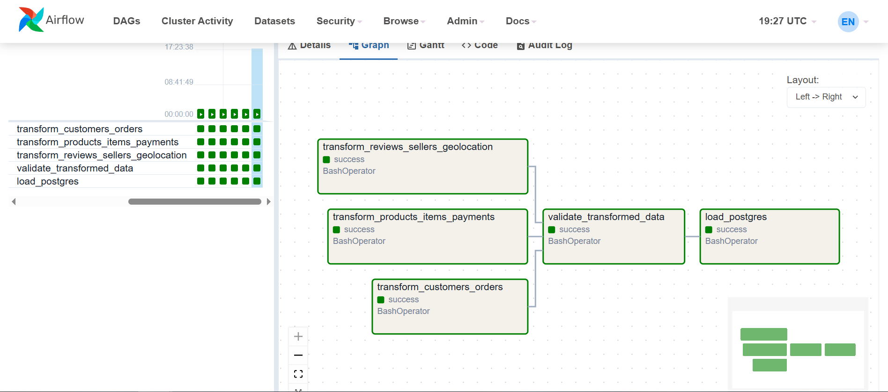
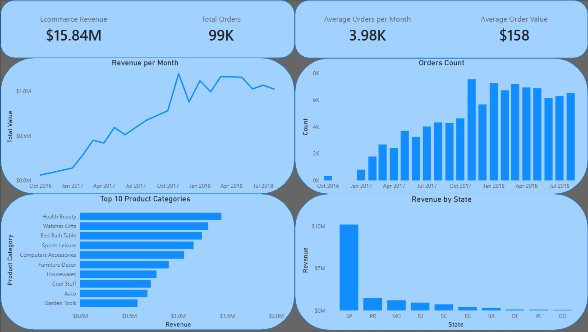
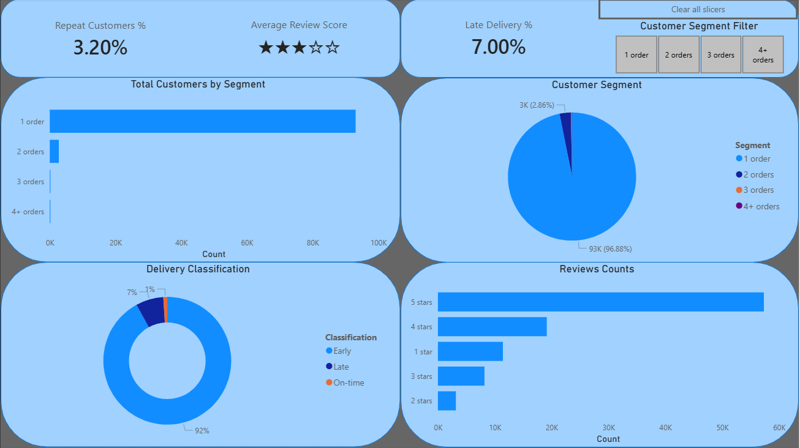
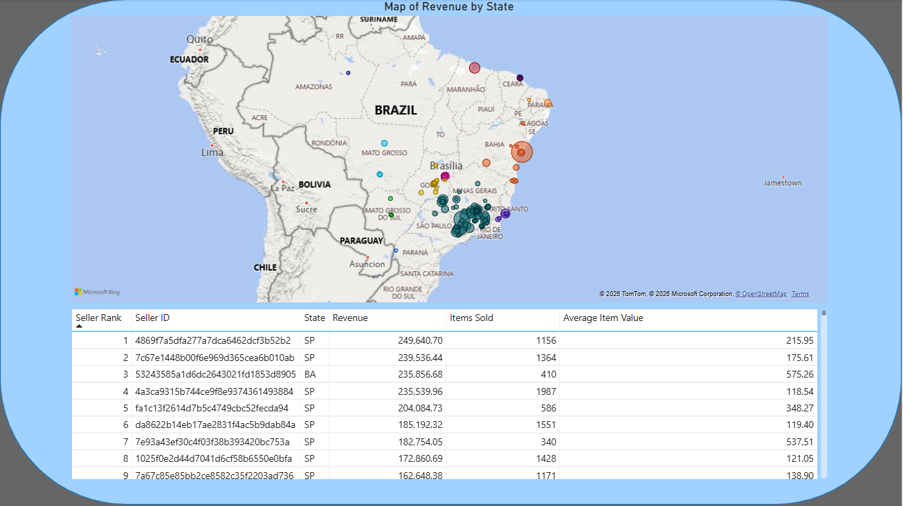

# Olist E-Commerce ETL Pipeline & Power BI Dashboard

## Project Overview

This project builds an end-to-end data engineering and analytics workflow using the Brazilian Olist e-commerce dataset.

The goal was to transform raw transactional CSV files into a validated PostgreSQL analytical database, orchestrate the pipeline with Apache Airflow, and build a Power BI dashboard for business analysis.

The project covers:

- Data cleaning and transformation with Python/Pandas
- Automated validation of primary keys, foreign keys, and business rules
- PostgreSQL schema design using fact and dimension tables
- Dockerized local PostgreSQL environment
- Apache Airflow orchestration
- Analytical SQL views for reporting
- Power BI dashboard for business insights

---

## Tech Stack

- Python
- Pandas
- PostgreSQL
- SQL
- Docker
- Apache Airflow
- Power BI
- Git/GitHub

---

## Dataset

The project uses the **Brazilian E-Commerce Public Dataset by Olist** from Kaggle.

The raw dataset contains multiple CSV files covering:

- Orders
- Customers
- Sellers
- Products
- Order items
- Payments
- Reviews
- Geolocation
- Product category translations

Raw data files are not committed to this repository. To reproduce the project, download the dataset from [Kaggle](https://www.kaggle.com/datasets/olistbr/brazilian-ecommerce).

---

## Project Architecture

The pipeline follows this flow:

```text
Kaggle Olist CSVs
        ↓
Python Transformation Scripts
        ↓
Transformed CSV Files
        ↓
Python Validation Layer
        ↓
Dockerized PostgreSQL Database
        ↓
SQL Table Creation + Data Loading
        ↓
Analytical SQL Views
        ↓
Power BI Dashboard
```

Apache Airflow orchestrates the main ETL workflow:

```text
Transform → Validate → Load
```

Docker provides a reproducible PostgreSQL environment for local development.

---

## Repository Structure

```text
olist_e_commerce_wsl/
│
├── dags/
│   └── olist_pipeline_dag.py
│
├── dashboard/
│   ├── screenshots/
│   └── power_bi/
|
├── scripts/
│   ├── transform/
│   ├── validation/
│   └── load/
│
├── sql/
│   ├── table_creation/
│   │   └── create_tables.sql
│   ├── views/
│   │   └── create_views.sql
│   └── analytical_queries.sql
│
├── docker-compose.yml
├── requirements.txt
├── README.md
└── .gitignore
```

---

## Data Model

The PostgreSQL database follows a star-schema-inspired analytical model.

Fact tables store measurable business events such as orders, payments, order items, and reviews. Dimension tables store descriptive context such as customers, products, sellers, and geolocation.

---

## Fact Tables

### `fact_orders`

Represents one row per order.

Contains:

- Order status
- Purchase and delivery timestamps
- Customer identifiers
- Data quality flags such as imputed approval or delivery timestamps

### `fact_order_items`

Represents one row per item within an order.

Contains:

- Product ID
- Seller ID
- Price
- Freight value
- Shipping limit date

Primary key:

```text
(order_id, order_item_id)
```

### `fact_payments`

Represents payment records for each order.

Contains:

- Payment type
- Payment installments
- Payment value

Primary key:

```text
(order_id, payment_sequential)
```

### `fact_reviews`

Represents review events linked to orders.

Reviews are modeled as a fact table rather than a dimension because each review is an event/observation connected to an order and contains measurable outcomes such as review score and review timing.

Primary key:

```text
(review_id, order_id)
```

---

## Dimension Tables

### `dim_customers`

Stores customer-related attributes.

Includes:

- `customer_id`
- `customer_unique_id`
- Customer city
- Customer state
- Customer zip code prefix

### `dim_products`

Stores product attributes.

Includes:

- Product category
- English category translation
- Product dimensions
- Product weight
- Product photo quantity
- Missing category flags

### `dim_sellers`

Stores seller attributes.

Includes:

- Seller ID
- Seller city
- Seller state
- Seller zip code prefix

### `dim_geolocation`

Stores geographical information by zip code prefix.

Includes:

- Zip code prefix
- Latitude
- Longitude
- City
- State

The original geolocation data contained multiple records per zip code prefix, so it was aggregated to one representative row per zip code prefix to support primary key constraints and clean joins.

---

## Schema Relationships

```text
dim_customers ──< fact_orders ──< fact_order_items >── dim_products
                      │                  │
                      │                  └── dim_sellers
                      │
                      ├──< fact_payments
                      │
                      └──< fact_reviews

dim_geolocation ──< dim_customers
dim_geolocation ──< dim_sellers
```

---

## ETL Pipeline

The ETL process is split into three main stages.

---

### 1. Transformation

Python/Pandas scripts transform the raw CSV files into analytics-ready tables.

Key transformation steps include:

- Converting timestamp columns to datetime format
- Adding `customer_unique_id` to the orders table for analytical convenience
- Handling missing approval timestamps with imputation and tracking flags
- Flagging delivery and status inconsistencies
- Merging product category translations into the products table
- Aggregating geolocation data to one row per zip code prefix
- Preserving NULLs where values are genuinely unknown
- Exporting transformed datasets to CSV files

---

### 2. Validation

Before loading the data into PostgreSQL, automated validation checks are performed.

Validation includes:

- Primary key uniqueness checks
- Foreign key coverage checks
- Null checks on critical fields
- Business rule checks
- Review score validity checks
- Non-negative numeric value checks

The pipeline fails if validation checks do not pass.

---

### 3. Loading

Validated CSV files are loaded into PostgreSQL in dependency order:

```text
dim_geolocation
dim_customers
dim_sellers
dim_products
fact_orders
fact_order_items
fact_payments
fact_reviews
```

The load process creates the database schema, truncates existing data for safe reruns, and reloads the transformed datasets.

---

## Airflow Orchestration

Apache Airflow orchestrates the ETL workflow.

The DAG runs three transformation tasks in parallel, then runs validation, and finally loads the data into PostgreSQL.

```text
transform_customers_orders
transform_products_items_payments
transform_reviews_sellers_geolocation
        ↓
validate_transformed_data
        ↓
load_postgres
```

### Airflow Successful Run




---

## PostgreSQL Analytical Views

Analytical SQL views were created in PostgreSQL to support the Power BI dashboard.

Examples include:

- Monthly revenue and order trends
- Top product categories by revenue
- Repeat customer segments
- Delivery classification: early, on-time, late
- Top sellers by revenue
- Review score distribution
- Data quality summary
- Seller geolocation revenue

These views allow Power BI to connect directly to PostgreSQL and consume clean reporting-ready datasets.

---

## Power BI Dashboard

The Power BI dashboard is organized into three main pages.

---

### 1. Business Performance

This page focuses on overall commercial performance.

It includes:

- Total revenue
- Total orders
- Average order value
- Monthly revenue trend
- Revenue by state
- Top product categories by revenue



---

### 2. Retention & Operational Performance

This page focuses on customer retention and delivery performance.

It includes:

- Customer order frequency segments
- Repeat customer analysis
- Early, on-time, and late delivery classification
- Reviews counts
- Average review score





---

### 3. Sellers & Geography

This page focuses on seller performance and geographic distribution.

It includes:

- Top sellers by revenue
- Seller revenue ranking
- Seller location map using latitude and longitude



---

## Key Data Engineering Decisions

### Reviews as a Fact Table

Reviews were modeled as a fact table because they represent customer feedback events linked to orders. They contain measurable values such as review score and timestamps, making them suitable for analysis over time and across products, sellers, or delivery outcomes.

### Payments as a Separate Fact Table

Payments were kept separate from orders because one order can have multiple payment records. The composite key `(order_id, payment_sequential)` preserves this one-to-many relationship.

### Order Items as a Separate Fact Table

Order items were modeled separately because one order can contain multiple items, products, or sellers. This enables product category, seller, freight, and item-level revenue analysis.

### Geolocation Aggregation

The raw geolocation table contained multiple records per zip code prefix. These were aggregated into one representative row per zip code prefix to support clean joins with customers and sellers.

### Preserving NULLs

Missing values were not blindly overwritten. NULLs were preserved where values were genuinely unknown, while flags were added where imputation or business-rule inconsistencies occurred.

---

## How to Run the Project

### 1. Clone the repository

```bash
git clone <your-repo-url>
cd olist-ecommerce-data-pipeline
```

### 2. Add raw data

Download the Olist dataset from Kaggle and place the raw CSV files in:

```text
data/raw/
```

### 3. Start Docker services

```bash
docker compose up -d
```

### 4. Open Airflow

Go to:

```text
http://127.0.0.1:8081
```

Login:

```text
username: admin
password: admin
```

### 5. Trigger the DAG

Run the following DAG from the Airflow UI:

```text
olist_ecommerce_etl_pipeline
```

The DAG will transform, validate, and load the data into PostgreSQL.

---

## Example Database Connection

For the Dockerized PostgreSQL database:

```text
Host: localhost
Port: 5433
Database: e_commerce
User: olist_user
Password: olist_password
```

Inside Docker containers, the PostgreSQL host is:

```text
postgres
```

with port:

```text
5432
```

---

## Data Quality

The pipeline includes a validation layer that checks:

- Primary key uniqueness
- Foreign key integrity
- Required field completeness
- Valid review score ranges
- Non-negative monetary values
- Business-rule consistency

The Power BI dashboard includes a data quality summary showing imputation rates and flagged order inconsistencies.

---

## Future Improvements

Possible future extensions:

- Add dbt for modular SQL transformations
- Add automated tests using Great Expectations or dbt tests
- Add CI/CD checks for validation scripts
- Deploy PostgreSQL and Airflow to a cloud environment
- Add incremental loading instead of full reloads
- Add monitoring and alerting for failed DAG runs

---

## Project Summary

This project demonstrates an end-to-end data engineering workflow from raw CSV data to a validated analytical database and business-facing dashboard.

It combines data cleaning, schema design, validation, orchestration, SQL analytics, and dashboarding into one reproducible pipeline.